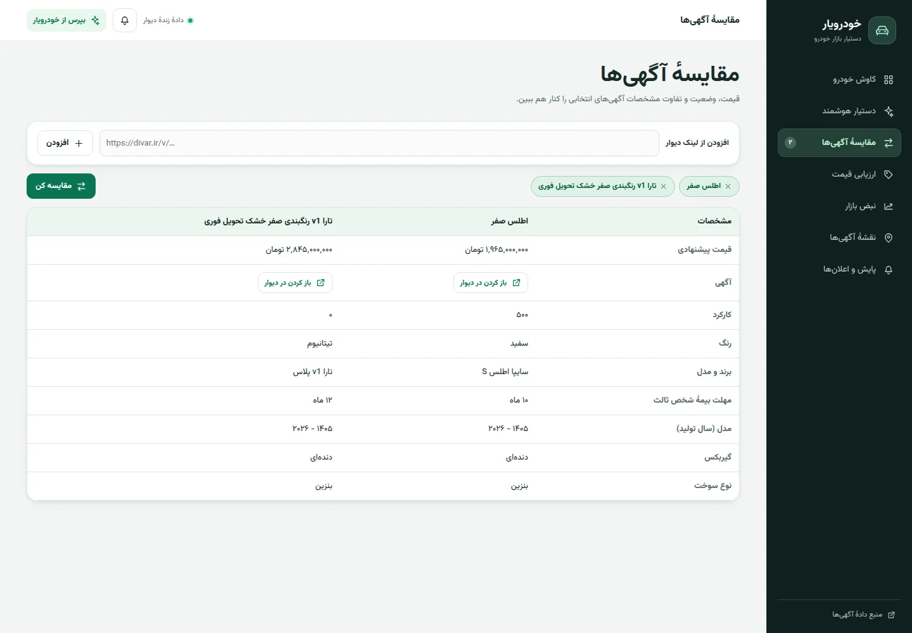
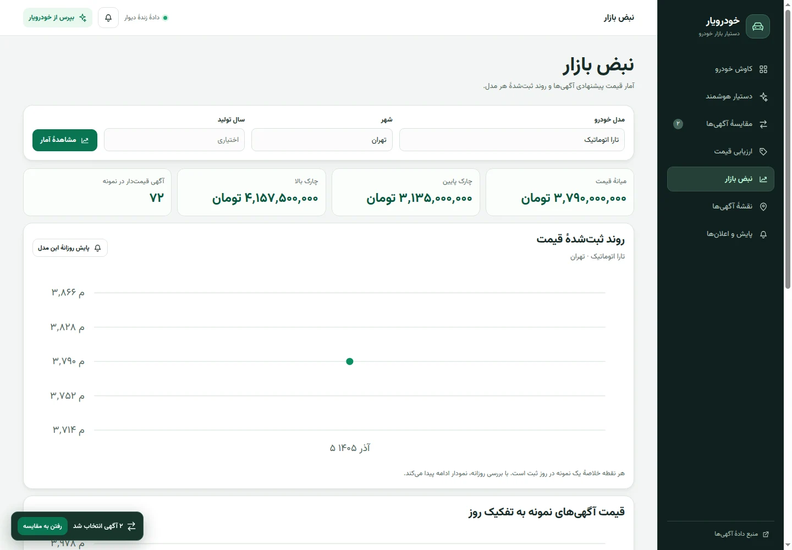
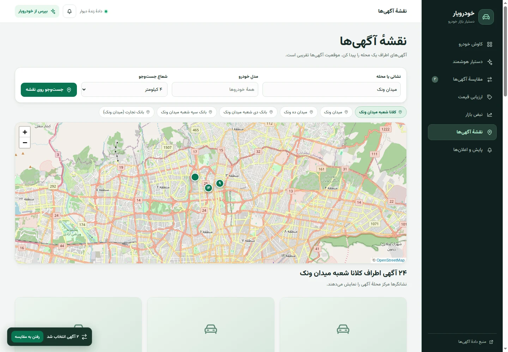
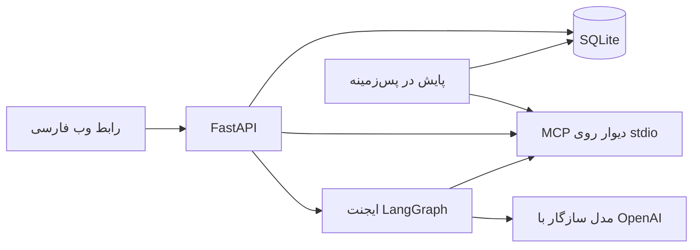

<div align="center">

# خودرویار · Khodroyar

**از پیدا کردن آگهی تا مقایسه و سنجیدن قیمت، در یک داشبورد فارسی.**

نمونه‌کار Full‑Stack برای جست‌وجو و تحلیل آگهی خودروهای سواری و وانت در ایران

`Python 3.12` · `FastAPI` · `LangGraph` · `MCP` · `SQLite` · `Leaflet`

</div>


خودرویار برای خریداری ساخته شده که می‌خواهد پیش از تماس با فروشنده، گزینه‌ها را محدود کند و بفهمد قیمت یک آگهی در مقایسه با خودروهای مشابه چه جایگاهی دارد. می‌توانی با فیلترهای دقیق جست‌وجو کنی یا همان خواسته را به فارسی از دستیار بپرسی. اگر هنوز گزینهٔ مناسب را پیدا نکرده‌ای، جست‌وجو را ذخیره کن تا آگهی‌های تازه در صندوق اعلان برنامه جمع شوند.

## چه کارهایی می‌شود انجام داد؟

| بخش | تجربهٔ کاربر |
| --- | --- |
| **کاوش آگهی‌ها** | جست‌وجوی زنده با شهر، محله، مدل، بودجه، سال تولید، کارکرد و گیربکس. نتایج را بر اساس تازگی، ارزان‌ترین آگهی‌ها، ارزش در محدودهٔ بودجه یا قیمت زیر میانهٔ نمونه ببین. |
| **جزئیات و مقایسه** | عکس‌ها و مشخصات منتشرشده را مرور کن، آگهی‌های مشابه و اطلاعات عمومی فروشنده را ببین و تفاوت حداکثر ۶ آگهی را در یک جدول بررسی کن. |
| **قیمت‌سنج** | لینک دیوار یا قیمت پیشنهادی یک خودرو را وارد کن و میانهٔ آگهی‌های مشابه، صدک قیمت، تعداد نمونه و میزان اطمینان ابزار را ببین. |
| **نبض بازار** | آمار قیمت پیشنهادی را به تفکیک مدل و شهر ببین و برای مدل‌های مهم، ثبت روزانهٔ روند قیمت را فعال کن. |
| **نقشه** | اطراف یک محله یا نشانی جست‌وجو کن. اگر مختصات آگهی در دسترس نباشد، برنامه مرکز محله را با برچسب تقریبی نشان می‌دهد. |
| **پایش و خروجی** | فیلترها را ذخیره کن، آگهی‌های تازه را در اعلان‌های داخل برنامه ببین و از نتایج فایل CSV یا JSONL بگیر. |
| **دستیار فارسی** | دربارهٔ خودرو سؤال بپرس یا یک جست‌وجو را با زبان طبیعی شروع کن. دستیار برای آگهی، قیمت روز و آمار بازار از ابزارهای MCP دیوار استفاده می‌کند. |

## نماهای برنامه

<table>
  <tr>
    <td align="center"><strong>مقایسهٔ آگهی‌ها</strong><br></td>
    <td align="center"><strong>نبض بازار</strong><br></td>
  </tr>
  <tr>
    <td align="center"><strong>نقشهٔ آگهی‌ها</strong><br></td>
    <td align="center"><strong>رابط موبایل</strong><br></td>
  </tr>
</table>

تصاویر از اجرای واقعی برنامه گرفته شده‌اند. قیمت‌ها و نتایج به زمان ثبت هر تصویر مربوط‌اند.

## معماری



مسیر گفت‌وگو در [agent.py](agent.py) تصمیم می‌گیرد چه زمانی مدل به ابزار نیاز دارد. مسیرهای جست‌وجو، مقایسه و نمودار، دادهٔ ساختاریافته را مستقیماً از [کلاینت MCP](divar.py) می‌گیرند و به رابط می‌رسانند. [API برنامه](workspace_api.py) و [ذخیره‌سازی SQLite](workspace_store.py) جست‌وجوهای ذخیره‌شده، اعلان‌ها و روند روزانه را مدیریت می‌کنند.

## اجرای محلی

به Python 3.12، ابزار `uv` و دسترسی شبکه به سرور مدل و دیوار نیاز است.

```bash
git clone https://github.com/hoomanabasi/khodroyar.git
cd khodroyar
uv venv --python 3.12
uv pip install -r requirements.txt
cp -n .env.example .env
```

فایل `.env` را با نشانی، کلید و نام مدل خودت پر کن. مدل باید فراخوانی ابزار را پشتیبانی کند.

```dotenv
AI_SERVER_IP=http://localhost:4000/v1
OPENAI_API_KEY=
AI_MODEL=primary-models
```

```bash
.venv/bin/python -m uvicorn main:app --host 127.0.0.1 --port 8765
```

[باز کردن رابط محلی](http://127.0.0.1:8765/) · [مستندات تعاملی API](http://127.0.0.1:8765/docs)

### چند سؤال برای شروع

> در تهران چند پژو ۲۰۶ تیپ ۲ تا ۸۰۰ میلیون تومان پیدا کن و لینک آگهی‌ها را بده.

> میانهٔ قیمت آگهی‌های تارا اتوماتیک V2 در تهران چقدر است؟ تعداد نمونه را هم بگو.

> قبل از خرید خودروی دست‌دوم، برای بررسی فنی و بدنه چه چیزهایی را چک کنم؟

### تنظیمات اختیاری

| متغیر | کاربرد |
| --- | --- |
| `DIVAR_MCP_PROXY` | پراکسی اتصال سرور MCP به دیوار |
| `WORKSPACE_DB` | مسیر پایگاه داده. پیش‌فرض `.data/workspace.sqlite3` است. |
| `WATCH_INTERVAL_SECONDS` | فاصلهٔ پیش‌فرض بررسی آگهی‌های تازه. مقدار اولیه ۹۰۰ ثانیه است. |
| `MAP_TILE_URL` و `MAP_TILE_ATTRIBUTION` | نشانی و متن انتساب ارائه‌دهندهٔ نقشه |

### تست‌ها

```bash
.venv/bin/python -m unittest discover -s tests -v
```

تست‌ها ماندگاری و جداسازی اعلان‌ها، جلوگیری از ثبت تکراری، مدیریت بررسی هم‌زمان و ثبت روزانهٔ تاریخچه را پوشش می‌دهند.

## داده و استقرار

قیمت‌ها پیشنهاد فروشندگان در آگهی‌اند و آمار به نمونهٔ همان جست‌وجو مربوط است. تاریخچهٔ قیمت از نخستین نمونهٔ ثبت‌شده ساخته می‌شود. بررسی دوره‌ای تا زمانی ادامه دارد که فرایند برنامه فعال باشد. فضای کار با کوکی مرورگر جدا می‌شود و همگام‌سازی بین دستگاه‌ها به حساب کاربری نیاز دارد.

این نمونه‌کار برای اجرای محلی تنظیم شده است. در استقرار عمومی، فایل SQLite را روی فضای پایدار نگه دار، برنامه را با یک worker اجرا کن و احراز هویت و محدودیت نرخ را در ورودی سرویس تنظیم کن. شرایط استفاده از داده‌های دیوار و ظرفیت سرویس نقشه را جداگانه در نظر بگیر. [سیاست استفاده از کاشی‌های OpenStreetMap](https://operations.osmfoundation.org/policies/tiles/)

آگهی‌ها از سرور غیررسمی و فقط‌خواندنی **divar-mcp** اثر سپهر رادمرد می‌آیند. پروژه نسخهٔ `0.3.0` را با مجوز MIT به‌عنوان وابستگی نصب می‌کند. [مخزن divar-mcp](https://github.com/sepehr071/divar-mcp) · [بستهٔ نسخهٔ ۰.۳.۰](https://pypi.org/project/divar-mcp/0.3.0/)
