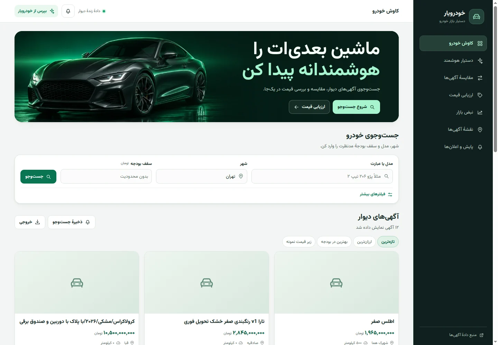

# خودرویار

خودرویار یک برنامهٔ فارسی و راست‌به‌چپ برای خودروهای سواری و وانت است. دستیار LangGraph با مدل سازگار با OpenAI به پرسش‌ها پاسخ می‌دهد و ابزارهای دیوار را فراخوانی می‌کند. صفحات کاوش، مقایسه، قیمت، نقشه و فروشنده داده‌های ساختاریافته را مستقیماً از MCP می‌خوانند.



## اجرا

Python 3.12 و دسترسی شبکه به سرور مدل و دیوار لازم است. از پوشهٔ پروژه:

```bash
uv venv --python 3.12
uv pip install -r requirements.txt
cp -n .env.example .env
```

در `.env`، مقادیر `AI_SERVER_IP`، `OPENAI_API_KEY` و `AI_MODEL` را تنظیم کنید. نشانی باید پایهٔ API سازگار با OpenAI باشد، مانند `http://localhost:4000/v1`. مدل باید فراخوانی ابزار را پشتیبانی کند. پراکسی اختیاری دیوار در `DIVAR_MCP_PROXY` تنظیم می‌شود.

```bash
.venv/bin/python -m uvicorn main:app --host 127.0.0.1 --port 8765
```

رابط در [localhost:8765](http://127.0.0.1:8765) و مستندات API در [localhost:8765/docs](http://127.0.0.1:8765/docs) باز می‌شوند.

## قابلیت‌ها

- کاوش زندهٔ آگهی‌ها با مدل، شهر، محله، بودجه، سال، کارکرد، گیربکس و عکس. سه حالت مجزای ارزان‌ترین، پیشنهاد متناسب با بودجه و قیمت زیر میانهٔ نمونه.
- کارت، گالری، مشخصات، مشابه‌ها، اطلاعات عمومی فروشنده و نمایشگاه، و مقایسهٔ ۲ تا ۶ آگهی.
- ارزیابی لینک یا قیمت پیشنهادی با میانه، صدک، تعداد نمونه و اطمینان؛ نمودار بازار و ثبت روزانهٔ مدل‌های در حال پایش.
- جست‌وجوی مکانی با نقشه. اگر دیوار نقطهٔ آگهی را برنگرداند، مرکز محله با برچسب تقریبی نمایش داده می‌شود.
- ذخیرهٔ فیلتر جست‌وجو، بررسی خودکار، صندوق اعلان داخل برنامه، و خروجی CSV یا JSONL.

قیمت‌های گزارش‌شده قیمت پیشنهادی آگهی‌اند. تاریخچهٔ روزانه از اولین نمونهٔ ثبت‌شده شکل می‌گیرد. اعلان‌های پایش در صندوق داخل برنامه قرار می‌گیرند و کار زمان‌بندی‌شده تا زمانی که فرایند برنامه فعال باشد ادامه دارد.

## تنظیمات استقرار

- `WORKSPACE_DB` مسیر فایل SQLite است و به‌صورت پیش‌فرض در `.data/workspace.sqlite3` قرار دارد. در استقرار آن را روی فضای پایدار قرار دهید و یک worker اجرای برنامه در نظر بگیرید.
- `WATCH_INTERVAL_SECONDS` فاصلهٔ بررسی جست‌وجوهاست و پیش‌فرض آن ۹۰۰ ثانیه است. بازار بر اساس روز تهران ثبت می‌شود.
- جست‌وجوهای ذخیره‌شده، اعلان‌ها و پایش مدل با کوکی همان مرورگر جدا می‌شوند. عرضهٔ عمومی به احراز هویت و محدودیت نرخ در ورودی سرویس نیاز دارد. همگام‌سازی فضای کار بین دستگاه‌ها به سازوکار حساب کاربری نیاز دارد. رابط محلی روی loopback اجرا می‌شود.
- `MAP_TILE_URL` و `MAP_TILE_ATTRIBUTION` برای ارائه‌دهندهٔ نقشه قابل تنظیم‌اند. پیش‌فرض OpenStreetMap برای تست تعاملی است. برای ترافیک عمومی از سرویس مناسب با شرایط و ظرفیت موردنیاز استفاده کنید. [سیاست نقشهٔ OpenStreetMap](https://operations.osmfoundation.org/policies/tiles/)
- برای سازگاری با استفادهٔ تجاریِ وابستگی نرم‌افزاری، نسخهٔ MIT یعنی `divar-mcp==0.3.0` نصب می‌شود. مجوز نرم‌افزار و شرایط دسترسی به دادهٔ دیوار مستقل‌اند. منبع MCP غیررسمی و فقط‌خواندنی است. [بستهٔ نسخهٔ ۰.۳.۰](https://pypi.org/project/divar-mcp/0.3.0/)

## بررسی

```bash
.venv/bin/python -m unittest discover -s tests -v
```
